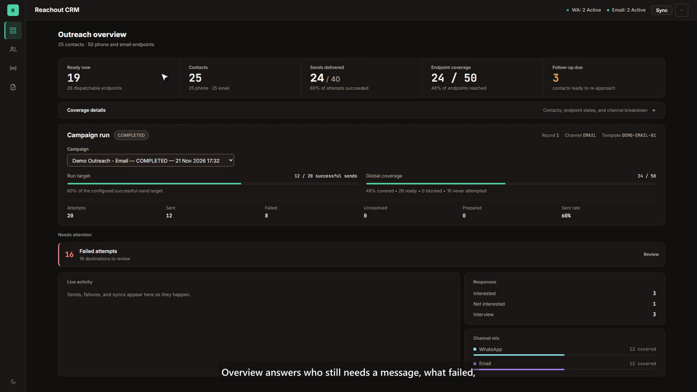

<p align="center">
  <a href="assets/reachout-demo.mp4"></a>
</p>

# Reachout

**Self-hosted recruiting outreach across WhatsApp and email, with an audit trail for every attempt.**

[](pyproject.toml)
[](app/main.py)
[](app/infrastructure/database.py)
[](tests)
[](#what-is-not-validated)
[](#privacy)

Reachout is a recruiting CRM for one operator on one machine. It imports HR contacts
from a spreadsheet, sends templated WhatsApp and email outreach, and records every send,
failure, reply and follow-up in SQLite. The same FastAPI process serves the JSON API and
the dashboard, so there is no cloud dependency, no build step and no Node runtime needed
to use it.

The design goal is not "send more messages". It is **never lose the record of a message**.
A dispatch moves through `PREPARED → SENDING → SENT / FAILED`, and a process that dies
mid-send leaves a `RECOVERY_REQUIRED` row instead of a silent retry.

<p align="center">
  <a href="assets/reachout-demo.mp4"><strong>▶ Watch the narrated walkthrough</strong></a>
  (2:51, 1080p, H.264/AAC)
  <br>
  <em>The dashboard on the seeded database, setup, a real WhatsApp and email send between the owner's accounts, and the crash-recovery path.</em>
  <br>
  <a href="assets/reachout-demo.captions.srt">Captions (.srt)</a>
  &nbsp;·&nbsp;
  <a href="narration.md">Narration script</a>
  &nbsp;·&nbsp;
  <a href="shotlist.md">Shot list</a>
</p>

---

> ## ⚠️ Working prototype — read this before pointing it at real people
>
> This is not a hosted product. It has **no authentication layer**, binds to `127.0.0.1`
> by default, and stores everything in one SQLite file. Run it on your own machine, for
> your own contacts, or not at all.
>
> WhatsApp dispatch drives **WhatsApp Web through a browser**, which can break without
> warning and may violate WhatsApp's terms of service. Email dispatch uses your own SMTP
> credentials. Neither channel is sandboxed: a live send is a real send. See
> [What is not validated](#what-is-not-validated).

---

## Contents

- [What this is](#what-this-is)
- [What the demo shows](#what-the-demo-shows)
- [How dispatch works](#how-dispatch-works)
- [Quickstart](#quickstart)
- [The dashboard](#the-dashboard)
- [Senders and authentication](#senders-and-authentication)
- [Demo database](#demo-database)
- [Configuration](#configuration)
- [Tests](#tests)
- [Repository map](#repository-map)
- [What is not validated](#what-is-not-validated)
- [What is reproducible](#what-is-reproducible)
- [Privacy](#privacy)
- [Troubleshooting](#troubleshooting)
- [FAQ](#faq)
- [Licence](#licence)

---

## What this is

| Component | What it does |
|---|---|
| **Company-first round-robin** | Contacts are interleaved across companies, so no employer receives two messages at once. Round 1 is C1-HR1, C2-HR1, C3-HR1; round 2 revisits C1 with its second contact. Quota-aware campaign pacing sits on top. |
| **Multi-endpoint coverage** | Every phone number and email address on a contact is a separate endpoint with its own state, retry count and exclusion rules. One dead address never hides the rest. |
| **Two real channels** | WhatsApp Web through Camoufox (Firefox) and SMTP email, sharing one template, scheduling and audit model. |
| **Provider-compliant pacing** | Per-sender inter-message spacing with human jitter, hourly and daily caps, and exponential backoff, configurable per channel. |
| **Encrypted credential vault** | SMTP secrets are stored with HMAC-SHA256 authenticated encryption over PBKDF2-derived keys, never in plaintext database rows. |
| **Transactional crash recovery** | Orphaned in-flight attempts surface in the Recovery Queue with `mark_sent` / `retry` / `cancel` instead of being silently retried. |
| **Lossless source sync** | Excel/CSV imports are fingerprinted with SHA-256 and never mutate existing records or historical audit rows. |
| **Local dashboard** | A dependency-free SPA with KPI overview, company hierarchy, sender health, templates, campaign controls and a WebSocket event stream. |

**Stack:** Python 3.10+, FastAPI, SQLAlchemy, SQLite (WAL), Camoufox, SMTP, vanilla JS.
**Shape:** hexagonal — pure domain rules in the middle, FastAPI and providers at the edges.

---

## What the demo shows

The recording runs against `data/demo.db`, a synthetic database built by
`scripts/seed_demo.py`. These are the numbers on screen, so the claims in the video can be
checked against the seed:

| Metric | Value |
|---|---|
| Contacts | 25 |
| Endpoints (phone + email) | 50 |
| Companies | 9 |
| Outreach attempts | 40 (24 delivered, 16 failed) |
| Follow-ups due | 3 |
| Unresolved attempts | 0 |
| Campaign | `Demo Outreach - Email`, COMPLETED, 12/20 successful sends |

Nothing in that database is a real person. The send dialog is opened and the template
rendered so the pre-send review step is visible, and the recording includes two real
sends — one WhatsApp message and one email — between the owner's own accounts, watched
through to the receiving side, so the delivery path is shown end to end.

---

## How dispatch works

One candidate in, one auditable attempt out:

1. **Select a candidate.** The prioritization policy interleaves companies and skips
   contacts whose endpoints are exhausted, suppressed or already messaged.
2. **Resolve an endpoint.** Each channel picks a live endpoint for the contact, honouring
   per-endpoint state and exclusion rules.
3. **Render the message.** The template is filled per contact and per channel, with the
   rendered body stored on the attempt as a snapshot.
4. **Prepare the attempt.** A row is written as `PREPARED` with an idempotency key before
   any network call.
5. **Send.** The attempt moves to `SENDING`; the provider adapter performs the send.
6. **Record the outcome.** `SENT` or `FAILED` with a failure code and detail. If the
   process dies between 5 and 6, startup recovery marks the row `RECOVERY_REQUIRED`
   rather than retrying a message that may already have left the machine.

The rate limiter enforces the channel spacing between sends; the scheduler persists
campaign state so a restart resumes where it stopped.

---

## Quickstart

### Prerequisites

- Python **3.10+**
- [`uv`](https://github.com/astral-sh/uv) (recommended), or a plain virtual environment
- Node.js **18+** — only for the UI unit tests (`npm test`), not for running the app

### 1. Sync and start

```powershell
uv sync
uv run uvicorn app.main:app --host 127.0.0.1 --port 8000 --reload
```

Open **http://localhost:8000**. The first start creates `data/reachout.db`, the real
database, unless `DATABASE_URL` points somewhere else.

> If `uv` is unavailable, use the project environment directly:
>
> ```powershell
> .venv/Scripts/python.exe -m uvicorn app.main:app --host 127.0.0.1 --port 8000
> ```

### 2. First-run checklist

1. **Add a sender** → **Senders**. WhatsApp: click **Re-authenticate** and scan the QR.
   Email: click **Reconfigure**, enter SMTP host/port/username/app password, then
   **Test and verify**.
2. **Create a template** → **Templates** → **+ Add Template**. A template holds the body,
   an optional email subject and an optional attachment path.
3. **Bring in contacts** → **Sync** in the header, pointed at an Excel/CSV source.
   Re-syncing is safe: existing records and history are never overwritten.
4. **Send** → **Contacts** → open a company → **Send**. Choose the endpoint, sender and
   template, then review the prefilled message.
5. **Watch progress** → **Overview** shows readiness, campaign state, delivery KPIs,
   failed attempts and follow-ups due.

### 3. Try it without any accounts

The dashboard works fully against the synthetic demo database, and the test suite uses
fake providers, so neither needs WhatsApp or SMTP:

```powershell
uv run python scripts/seed_demo.py
$env:DATABASE_URL = "sqlite:///data/demo.db"
uv run uvicorn app.main:app --host 127.0.0.1 --port 8000
```

See [Demo database](#demo-database) for switching back.

---

## The dashboard

The SPA is served by FastAPI at the root URL. Navigation is hash-based, so every view has
a stable link.

| View | Link | What it does |
|---|---|---|
| **Overview** | `/#/overview` | Coverage KPIs, the campaign run deck (pause/resume), needs-attention queue (failed attempts + recovery), live activity, response outcomes and channel mix. |
| **Contacts** | `/#/contacts` | Company hierarchy, search and filters across endpoints, CRM outcomes and follow-ups; send a templated message on either channel. |
| **Senders** | `/#/senders` | WhatsApp QR authentication and health checks, SMTP configuration and live verification, daily and hourly limits. |
| **Templates** | `/#/templates` | Create and edit templates with variable substitution and attachment paths. |

Canonical domain events stream over `/api/events/ws` (WebSocket), with `/api/events/stream`
(SSE) and `/api/events/history` for clients that prefer them. Sends, failures, campaign
state changes and recovery requirements appear without a refresh.

The button at the bottom of the left rail switches **System / Light / Dark**. The choice is
saved per browser in `localStorage`, and **System** follows the OS setting live.

---

## Senders and authentication

### WhatsApp (Camoufox / Firefox)

1. Open **Senders**.
2. Under WhatsApp Senders, click **Re-authenticate** on the target row.
3. Scan the QR with your phone.
4. The session manager persists the authenticated profile under `.sessions/`, which is
   git-ignored.

Install the browser engine once if it is missing:

```powershell
uv run python -m camoufox fetch
```

### Email (SMTP vault)

1. Open **Senders** and click **Reconfigure** on an email sender.
2. Provide the SMTP host, port (for example `smtp.gmail.com:587`), username and app
   password.
3. Credentials are encrypted at rest by
   `app.infrastructure.security.credential_vault.CredentialVault` — HMAC-SHA256
   authenticated encryption over a PBKDF2-derived key.
4. Click **Test and verify** to perform a live SMTP TLS handshake.

---

## Demo database

`scripts/seed_demo.py` builds a **separate** database, `data/demo.db`, with fictional
companies, contacts, templates, campaigns, attempts and follow-up reminders. It copies
only the sender-account rows from `data/reachout.db` — never credentials, real contacts or
history — so an already-authenticated environment can be reused safely.

```powershell
# Stop the running app first; the script refuses to write to a locked database.
uv run python scripts/seed_demo.py

$env:DATABASE_URL = "sqlite:///data/demo.db"
uv run uvicorn app.main:app --host 127.0.0.1 --port 8000
```

`DATABASE_URL` is read once at process start. To return to real data, close the server,
clear the variable and start again:

```powershell
$env:DATABASE_URL = ""
uv run uvicorn app.main:app --host 127.0.0.1 --port 8000
```

To confirm which database is actually in use, compare row counts:

```powershell
.venv/Scripts/python.exe -c "import sqlite3; [print(p, sqlite3.connect(p).execute('select count(*) from companies').fetchone()[0]) for p in ('data/reachout.db','data/demo.db')]"
```

---

## Configuration

Reachout works with safe defaults out of the box. Everything below is optional.

| Variable | Default | Description |
|---|---|---|
| `DATABASE_URL` | `sqlite:///data/reachout.db` | Database the API process opens. Point it at `data/demo.db` or a copy. |
| `VAULT_ENCRYPTION_KEY` | Auto-generated in `.sessions/.vault_key` | Master key for SMTP credential encryption. |
| `OUTREACH_CHANNEL_DELAY_WA` | `120.0` | Inter-message spacing for WhatsApp, in seconds. |
| `OUTREACH_CHANNEL_DELAY_EM` | `60.0` | Inter-message spacing for Email, in seconds. |

`.env.example` lists the optional sender-profile fields the templates can interpolate.
Copy it to `.env` and fill in your own values; `.env` is git-ignored.

### Utility scripts

| Script | Purpose |
|---|---|
| `scripts/seed_demo.py` | Rebuild `data/demo.db` with fictional data, reusing sender rows from the real database. |
| `scripts/fetch_fonts.py` | Re-download the Inter and JetBrains Mono variable fonts used by the dashboard. |

Both write only to git-ignored paths, so neither touches tracked files.

---

## Tests

### Backend (pytest)

```powershell
uv run pytest
```

Focused runs:

```powershell
uv run pytest tests/unit/           # unit
uv run pytest tests/integration/    # integration
uv run pytest tests/e2e/            # browser end-to-end (~3 min)
uv run pytest -m "not e2e"          # everything except the browser suite (~45s)
```

Observed on this checkout: **373 passed** for `tests/unit tests/integration`.

> **Run the suite serially.** Several tests drive real threads and sleeps (scheduler
> pause/resume, server restart, recovery race resolution) and become timing-sensitive
> under parallel load. `pytest-xdist` (`-n`) is not supported. A 300 s per-test timeout is
> configured so a hang fails loudly.

The E2E suite starts its own server on `127.0.0.1:8899` against an isolated temporary
database, so it never touches `data/reachout.db`.

### Frontend (Node)

```powershell
npm test
```

Runs `ui/tests/*.test.mjs` with Node's built-in runner: formatting and masking helpers,
the action registry, load-state gating and renderer escaping. No `npm install` required.

Lint and format the backend with `uv run ruff check app tests` and `uv run ruff format`.

### Live provider tests (send real messages)

`tests/e2e/live/` dispatches a **real** WhatsApp message and a **real** email. It is
skipped unless explicitly opted in, so a plain `uv run pytest` never sends anything.

Sender accounts are discovered from `ACTIVE` rows in `sender_accounts`, and the recipient
must be another one of your own accounts (sender ≠ recipient is enforced).

```powershell
# Both channels: needs >= 2 ACTIVE accounts per channel
$env:LIVE_E2E="1"
uv run pytest tests/e2e/live

# One channel
$env:LIVE_EMAIL_E2E="1";    uv run pytest tests/e2e/live/test_email_live.py
$env:LIVE_WHATSAPP_E2E="1"; uv run pytest tests/e2e/live/test_whatsapp_live.py

# Pin a sender and recipient when only one account is ACTIVE
$env:LIVE_WHATSAPP_E2E="1"
$env:LIVE_TEST_WHATSAPP_SENDER_ID="wa_919000000000"
$env:LIVE_TEST_WHATSAPP_RECIPIENT="919000000001"
uv run pytest tests/e2e/live/test_whatsapp_live.py

# Clear the opt-in afterwards
$env:LIVE_E2E=""; $env:LIVE_WHATSAPP_E2E=""; $env:LIVE_EMAIL_E2E=""
```

- WhatsApp runs **headed** by default. Headless is a strong automation signal, so
  `PLAYWRIGHT_HEADLESS=true` is an explicit opt-in.
- An expired session skips with `ERR_AUTH_REQUIRED` rather than failing; re-authenticate
  via **Senders**.
- Both tests build fixtures in an in-memory SQLite database, so the production database is
  never written to — only the outbound message is real.

---

## Repository map

```text
reachout/
├── README.md                    This file
├── pyproject.toml               Dependencies and project metadata
├── uv.lock                      Locked Python dependency versions
├── package.json                 Node test script (no runtime dependency)
├── .env.example                 Optional sender-profile fields, all blank
│
├── app/                         The application
│   ├── domain/                  Pure entities, value objects and policies
│   │   ├── contact.py           Contact model and E.164 normalisation
│   │   ├── outreach_attempt.py  Immutable attempt audit record
│   │   └── policies/            Prioritisation, rotation, dedup, resend rules
│   ├── ports/                   Protocol interfaces (repositories, providers, clock)
│   ├── infrastructure/          Adapters
│   │   ├── database.py          SQLAlchemy engine and SQLite WAL configuration
│   │   ├── models.py            Relational schema
│   │   ├── providers/           Camoufox WhatsApp and SMTP email adapters
│   │   ├── scheduler/           Persistent scheduler, rate limiter, crash recovery
│   │   ├── security/            Encrypted credential vault
│   │   └── source/              Non-destructive Excel/CSV reader and synchroniser
│   ├── services/                Use-case orchestrators wired through ServiceContext
│   ├── api/                     FastAPI REST and WebSocket routers
│   └── main.py                  Application entry point
│
├── ui/                          Dashboard SPA (vanilla JS, no build step)
├── tests/                       Unit, integration, browser and live-provider suites
├── scripts/                     Demo seeding and font refresh helpers
├── assets/                      Demo video, captions and poster
├── narration.md                 Script of the walkthrough, with its real timestamps
├── shotlist.md                  Scene-by-scene shot list for the same cut
└── data/                        Local SQLite databases — git-ignored, never committed
```

**Where to start reading:** `app/domain/policies/prioritization.py` for the company-first
rule, `app/infrastructure/scheduler/crash_recovery.py` for the recovery state machine,
and `app/services/outreach_service.py` for the dispatch path.

---

## What is not validated

These are known, open limitations. They are listed so the tool is used with the right
amount of caution.

1. **No authentication.** There are no users, roles or sessions. The dashboard and API
   assume a trusted operator on localhost. Do not expose port 8000 to a network.
2. **WhatsApp automation is fragile and may breach terms.** Dispatch drives WhatsApp Web
   in a browser. Markup changes, session expiry and anti-automation measures can break it
   at any time, and automated messaging may violate WhatsApp's terms of service. Account
   bans are a real risk.
3. **A send can be ambiguous.** Crash recovery covers process death. It cannot know
   whether a provider accepted a message that the process never recorded; those rows are
   surfaced for a human decision, not resolved automatically.
4. **WhatsApp delivery is not confirmed end to end.** The provider clicks Send and then
   reads WhatsApp's own marker for the bubble it just queued, so a rejected message is
   recorded as `FAILED` rather than `SENT`. That marker is still only the sending
   client's view: a session that has not finished syncing can accept the click and then
   fail to transmit, and a message the recipient's device never receives while the client
   shows a tick cannot be told apart from a delivered one.
5. **Pacing is client-side.** Inter-message delays and caps are enforced by this process,
   not by the provider. They reduce risk; they do not guarantee compliance.
6. **SQLite is single-writer.** One process, one file. There is no multi-instance or
   multi-user story, and no Postgres path.
7. **Spreadsheet schema is assumed.** The Excel/CSV reader expects the columns the
   synchroniser maps. A different sheet layout needs code changes, not configuration.
8. **Windows-first.** The documented commands are PowerShell and the Camoufox path has
   only been exercised on Windows. Linux and macOS are untested.
9. **No CI.** The test counts in this README were measured locally, not by a hosted
   runner. There is no workflow file.

---

## What is reproducible

| Task | From this checkout? | Notes |
|---|---|---|
| Install, start the app, open the dashboard | **Yes** | `uv sync` and one uvicorn command. |
| Run the unit and integration suites | **Yes** | Fake providers; no accounts or network needed. |
| Run the browser E2E suite | **Yes** | Starts its own server on port 8899. |
| Build the synthetic demo database | **Yes** | `scripts/seed_demo.py`; deterministic fixture, not real contacts. |
| Send a real WhatsApp or email | **With your own accounts** | Requires an authenticated session or SMTP credentials. |
| Reproduce the recorded video | **No** | The recording scripts and scene captures are not part of this repository. |
| Reproduce the original contact import | **No** | The source workbooks hold real contact data and are not distributed. |

---

## Privacy

The dashboard treats phone numbers and email addresses as personal data, and the demo
recording follows the same rules:

- Endpoint rows show the channel and a state badge, never the address.
- The send modal labels endpoints "WhatsApp endpoint 1", "Email endpoint 2", and senders
  "WhatsApp sender 1", "Email sender 2".
- Failed-attempt and recovery rows show a masked destination (`e•••••@domain.com`,
  `+91••••123`).
- The activity timeline and duplicate-contact report omit destinations and shared
  identifiers.

The full values still exist in the database and are used by the send pipeline. For
debugging, query SQLite directly rather than expecting them in the UI.

The recording uses `data/demo.db` only. Endpoints are masked throughout, and no message is
sent.

---

## Troubleshooting

**The dashboard shows data from the wrong database.**
Check `DATABASE_URL` in the shell that started the server. It is read once at startup;
changing it requires a restart. `data/reachout.db` is the default, `data/demo.db` is the
synthetic demo.

**A CSS or JS change did not appear after a reload.**
Static asset URLs carry a content hash computed at startup (`ASSET_VERSION` in
`app/main.py`). Restart the server after editing `ui/`, then hard-refresh.

**Port 8000 is already in use.**

```powershell
Get-NetTCPConnection -LocalPort 8000 -State Listen | ForEach-Object { Stop-Process -Id $_.OwningProcess -Force }
```

**The Senders page shows nothing.**
Run the server from the project root so `data/` and `.sessions/` resolve correctly, and
confirm the database file exists.

**`uv` is not installed.**

```powershell
powershell -ExecutionPolicy ByPass -c "irm https://astral.sh/uv/install.ps1 | iex"
```

If a virtual environment already exists, bypass `uv` entirely:

```powershell
.venv/Scripts/python.exe -m uvicorn app.main:app --host 127.0.0.1 --port 8000
```

---

## FAQ

### Do I need WhatsApp and SMTP accounts to try it?

No. The demo database and the unit/integration suites use fake providers. You only need
real accounts to send a real message.

### Will it get my WhatsApp number banned?

It might. The tool automates WhatsApp Web, which is not a supported integration. Pacing,
jitter and caps reduce the risk; nothing here removes it.

### Can I run it on a server for my team?

Not safely. There is no authentication or authorisation layer, and the database is a
single SQLite file. Treat it as single-operator desktop software.

### Where does my data live?

In the SQLite file named by `DATABASE_URL`, plus the encrypted SMTP vault under
`.sessions/`. Both are git-ignored. Nothing is sent to a third party except the messages
you dispatch.

### Why not Postgres or a message queue?

Because the target is one operator on one machine. A single process with SQLite keeps the
audit trail transactional and the setup to two commands.

### How was the video made?

Screen recordings of the real app against `data/demo.db`, assembled with ffmpeg. The live
scene is the app itself driving Camoufox over WhatsApp Web and SMTP for email, filmed on
the sending machine and on the receiving browsers, with destinations and mail identities
masked. The recording scripts are not part of this repository, so the video is
documentation, not a build artifact.

### Is the demo data real?

No. `scripts/seed_demo.py` generates fictional companies, contacts, templates and
attempts. The numbers in [What the demo shows](#what-the-demo-shows) match that fixture.

---

## Licence

No licence file is included yet, so default copyright applies: the code is public to
read, but not licensed for redistribution or reuse. Add an explicit `LICENSE` (Apache-2.0
or MIT) before treating this as an open-source project.

The demo video and captions in `assets/` are part of the same work and follow the same
terms.
